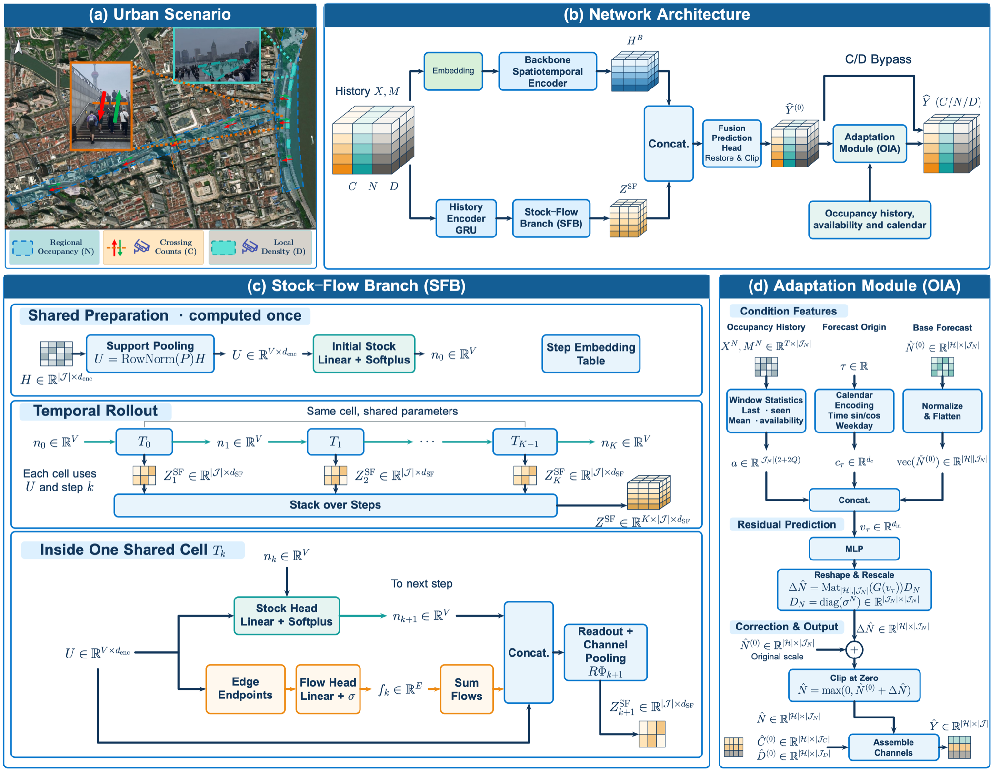
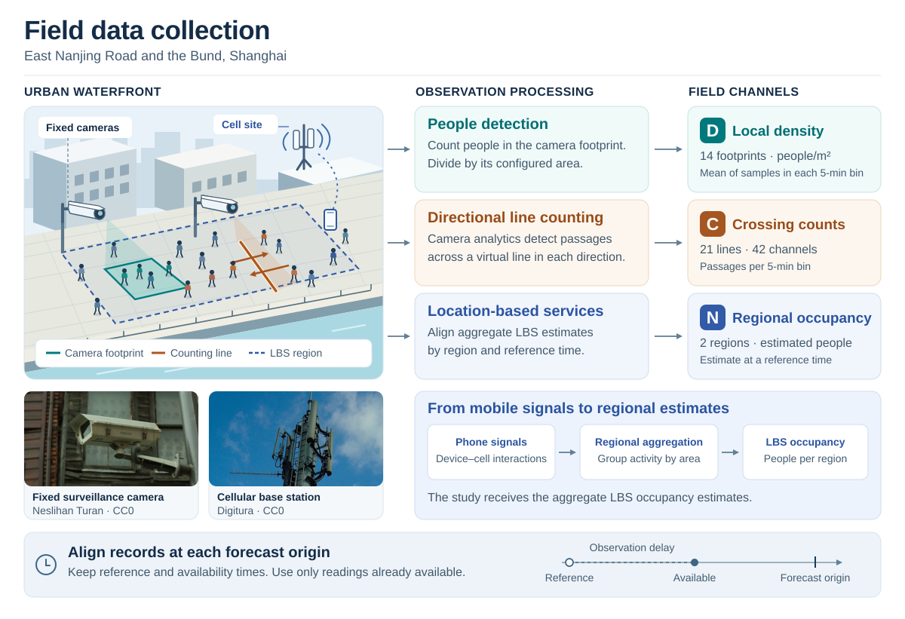
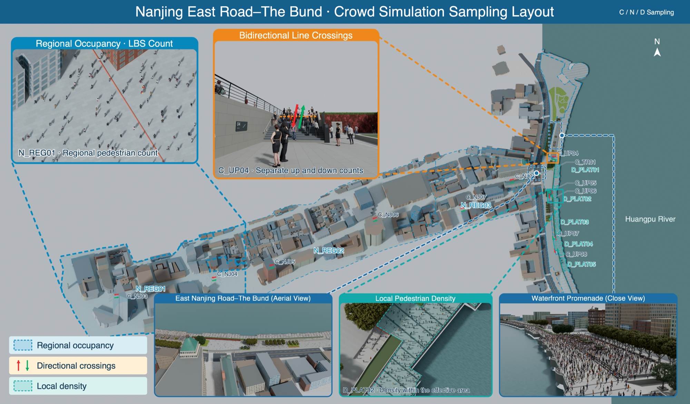
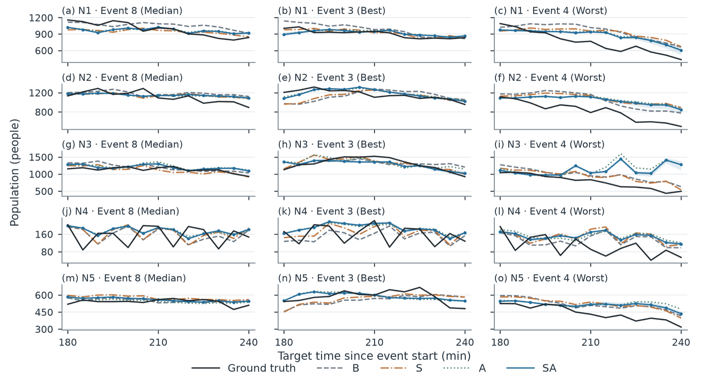

# StockFlowCrowd

**Stock–flow modeling and observation-informed adaptation for 5–30-minute crowd forecasts**

An urban crowd can be observed through regional occupancy estimates, camera density footprints, and directional counting lines. Each measure covers a different part of the scene, summarizes time differently, and can become available at a different time. StockFlowCrowd combines a spatiotemporal backbone with two jointly trained modules to forecast all three measures from the preceding 120 minutes.

## Research highlights



| Highlight | What it does |
| --- | --- |
| **Stock–Flow Branch (SFB)** | Rolls out latent population stocks and directed transfers over a scene graph. Observation operators connect these states to the spatial support and time window of each measurement. The projected features feed the forecast head. Sim-SH-ENB provides auxiliary supervision for occupancy in all five regions. |
| **Observation-Informed Adaptation (OIA)** | Uses 5-, 15-, 30-, and 120-minute occupancy summaries, observation availability, calendar context, and the base forecast to learn a residual for each region and horizon. |
| **Availability-aware forecasting** | Includes only readings available at the forecast origin. It tracks missing readings separately from true zeros and starts each forecast with a fresh dynamic state. |

## Field sensing and simulation setup



The field study combines fixed-camera measurements with aggregated location-based service (LBS) estimates on **East Nanjing Road and the Bund, Shanghai**. The drawing uses generic outdoor cameras and a schematic cellular site to illustrate the hardware and data collection. The study uses the aggregate LBS feed. The provider's signal-processing method and equipment layout are unspecified. [Outdoor camera reference](https://www.axis.com/en-us/products/axis-p14-series) · [Camera counting methods](https://whitepapers.axis.com/en-us/axis-counting-solutions) · [Population estimation from mobile network data](https://pmc.ncbi.nlm.nih.gov/articles/PMC4234567/).

The MassMotion scene emulates these measurement supports with virtual regions, footprints, and lines along the pedestrian street, crossings, and waterfront promenade.



| Observation | Field sensing and processing | Simulation sampling |
| --- | --- | --- |
| **N · Regional occupancy** | Aggregate LBS estimates for a larger region, with separate reference and availability times. | Count pedestrians inside each region in 30-second snapshots. Use the last available snapshot in each history interval and the exact target snapshot for labels. |
| **D · Local density** | Detect people in a camera footprint and divide the count by its configured area in square metres. | Compute the same ratio in virtual footprints and average 10 snapshots per five-minute interval. |
| **C · Directional crossings** | Count passages in each direction across a camera line and accumulate valid counts in five-minute intervals. | Detect intersections between lines and segments joining successive pedestrian positions. Debounce repeated detections and bin confirmed crossings by availability time. |

## Sim-SH-ENB dataset

**15 simulated events · 34 channels · 195 forecast origins.** The channel order is five density channels, five occupancy channels, and 24 directional channels from 12 bidirectional lines. Each origin uses 24 five-minute history steps and predicts six horizons at five-minute increments. The 13 origins per event span elapsed minutes 150–210, before the dispersal phase.

| Split | Event IDs | Forecast origins |
| --- | --- | ---: |
| Train | 1, 5, 9–15 | 117 |
| Validation | 2, 6, 7 | 39 |
| Test | 3, 4, 8 | 39 |

**Download** · Baidu Netdisk share link pending.

The archive contains aggregated benchmark windows, validity masks, availability features, simulated channel and graph metadata, training-only scaling statistics, and held-out labels. The source simulator projects and pedestrian trajectories are outside the release. SH-ENB field observations are restricted. The simulation histories are complete. All 15 source runs fell short of the study’s physical acceptance criteria, so the three test events support exploratory comparisons.

## Field evidence and practical use

In the SH-ENB backtest, forecasts used asynchronous camera and LBS observations available at issue time. The field collection had 58 channels, with 56 scored in the primary panel. A single forecast gives operators a view of expected regional buildup, local crowding, and directional passage demand at six lead times. A documented waterfront surge with a prolonged occupancy data gap was substantially underestimated, which identifies when the forecasts need corroborating observations.

| Backbone | Field SH-ENB, reduction in J | Sim-SH-ENB, reduction in J |
| --- | ---: | ---: |
| MegaCRN | **6.9%** | **5.9%** |
| STID | 1.4% | 4.2% |
| STAEformer | **2.6%** | **4.1%** |

The table compares the combined model with its backbone-only counterpart across three seeds. **Bold** marks reductions that were significant after multiple-comparison correction in the study. J averages scaled absolute errors with equal weight for D, N, and C. With MegaCRN, field occupancy scaled MAE declined by 11.6%. These results come from retrospective field evaluation and event-level simulation tests.



Thirty-minute MegaCRN forecasts on the three test events. From left to right, the columns show the median gain, largest gain, and largest loss for the combined model. The model tracks the occupancy trajectory more closely on Events 8 and 3, while Event 4 illustrates a case with larger errors.

## Run the simulation code

Use Python 3.10 or later and extract the archive into `data/` so that `data/Sim-SH-ENB/contract.json` exists.

```bash
python -m pip install -r requirements.txt
python train.py train --data-dir data/Sim-SH-ENB \
  --backbone megacrn --variant SA --checkpoint runs/megacrn-sa.pt
python train.py evaluate --data-dir data/Sim-SH-ENB \
  --checkpoint runs/megacrn-sa.pt
```

The default fit uses 80 epochs and keeps the checkpoint with the lowest validation J. Use `--epochs 2` for a quick check. The code supports `megacrn`, `stid`, and `staeformer`, with variants `B` (backbone), `S` (SFB), `A` (OIA), and `SA` (both). Run seeds 0, 1, and 2 separately for a three-seed comparison. The runner uses CPU by default and accepts `--device cuda`.

**Associated manuscript** · *Multi-Source Crowd Forecasting in Open Urban Hotspots via Stock–Flow Physical Modeling and Observation-Informed Adaptation.*
